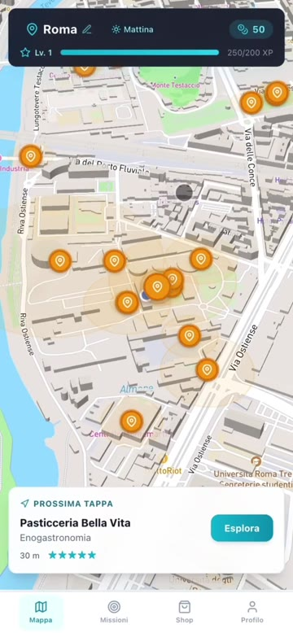
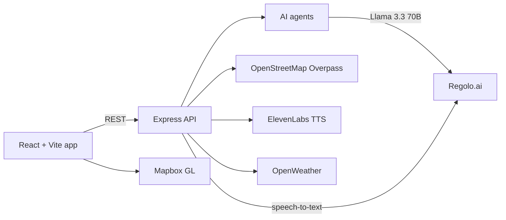

<div align="center">

# Itinera

**Turn a walk through the city into an AI-powered adventure.**

Itinera is a location-based city discovery game: it finds the points of interest around you,
tells their story in a voice tailored to you, and challenges you with quizzes and voice games
while you explore.

[](https://github.com/Odex2/Itinera/actions/workflows/ci.yml)
[](LICENSE)


Built at the **Codemotion Hackathon "Hack Nation"** (Rome, 28–29 March 2026)
for the **"Play the City"** challenge by Gunpowder.

[Pitch deck](docs/pitch/index.html) · [Pitch PDF](docs/pitch/Itinera-pitch.pdf) · [Demo video](docs/pitch/demo.mp4)

</div>

## Screenshots

| Onboarding | City selection | Map | AI story | Quiz |
| :---: | :---: | :---: | :---: | :---: |
|  |  |  |  |  |

The interface is in Italian, as the game was designed for the Rome hackathon.

## How it works

1. **Build your explorer profile.** A short onboarding quiz maps your interests and personality
   (food, culture, art, history, nature, shopping, sport, ...).
2. **Pick a city.** Use your real position or explore any city virtually.
3. **Explore the map.** Real points of interest come from OpenStreetMap, enriched by AI with
   hidden gems, filtered by opening hours and weather.
4. **Unlock the story.** Each place gets a fresh narration written for your profile and the time
   of day, with a hidden fact and optional text-to-speech.
5. **Take the challenge.** Answer AI-generated quizzes, or speak your answer in a voice
   challenge, to earn XP, coins, badges and rewards.

## Features

- Interactive Mapbox map with 3D buildings, clustering and proximity detection
- Real POI discovery from the OpenStreetMap Overpass API, enriched with AI-suggested hidden gems
- Personalized AI narration based on interests, personality and time of day
- AI-generated quizzes with written and spoken answers (speech-to-text + answer validation)
- Text-to-speech narration with ElevenLabs
- Weather-aware and opening-hours-aware suggestions
- Gamification: XP and levels, coins, shop, missions, badges and a leaderboard

## Architecture



The backend is organised around small, single-purpose AI agents:

| Agent | Role |
| --- | --- |
| `dialogueWriter` | Writes the personalized story of a place |
| `quizGenerator` | Creates quizzes from the place and the user's interests |
| `answerValidator` | Checks free-text answers |
| `challengeDialogue` | Builds spoken challenges |
| `poiDiscoverer` | Combines Overpass results with AI-suggested hidden gems |

```text
.
├── UI/                  # React + Vite + Tailwind frontend
│   └── src/
│       ├── components/  # Screens and UI components
│       ├── hooks/       # Game state and geolocation
│       ├── services/    # API client
│       └── App.tsx      # Main application flow
├── server/              # Express + TypeScript backend
│   └── src/
│       ├── agents/      # AI agents (narration, quizzes, discovery, validation)
│       ├── routes/      # AI, discovery, weather and voice endpoints
│       ├── services/    # External API clients
│       └── index.ts     # HTTP server entry point
└── docs/                # Pitch deck, demo video, screenshots, dev notes
```

## Tech stack

| Area | Technologies |
| --- | --- |
| Frontend | React 18, TypeScript, Vite, Tailwind CSS, Mapbox GL JS, react-map-gl, Lucide icons |
| Backend | Node.js, Express, TypeScript (ESM) |
| AI | Regolo.ai (Llama 3.3 70B Instruct, faster-whisper large v3) via an OpenAI-compatible API |
| Data and services | OpenStreetMap Overpass API, ElevenLabs, OpenWeather |
| Tooling | ESLint, GitHub Actions |

## Getting started

### Prerequisites

- Node.js 18 or newer and npm
- A [Mapbox](https://account.mapbox.com/access-tokens/) public token
- A [Regolo.ai](https://regolo.ai) API key for the AI features
- Optional: [ElevenLabs](https://elevenlabs.io) and [OpenWeather](https://openweathermap.org/api) keys

### Install

```bash
git clone https://github.com/Odex2/Itinera.git
cd Itinera

cd server && npm install && cp .env.example .env
cd ../UI && npm install && cp .env.example .env
```

Then fill in your keys in `server/.env` and `UI/.env`. Never commit these files.

### Run

```bash
# Terminal 1: backend on http://localhost:3001
cd server && npm run dev

# Terminal 2: frontend on the URL printed by Vite
cd UI && npm run dev
```

Check the backend with `curl http://localhost:3001/api/health`.
In VS Code you can also run the **Start All (Server + UI)** task.

### Scripts

| Folder | Command | Description |
| --- | --- | --- |
| `UI/` | `npm run dev` | Start the Vite dev server |
| `UI/` | `npm run build` | Production build |
| `UI/` | `npm run lint` | ESLint |
| `UI/` | `npm run typecheck` | TypeScript checks |
| `server/` | `npm run dev` | Start the API with file watching |
| `server/` | `npm run build` | Compile to `dist/` |
| `server/` | `npm start` | Run the compiled API |

## API

| Route | Purpose |
| --- | --- |
| `GET /api/health` | Health check |
| `POST /api/ai/narration` | Personalized narration for a POI |
| `POST /api/ai/challenge` | Generate quizzes and challenges |
| `POST /api/ai/validate` | Validate a written answer |
| `POST /api/ai/discover-pois` | Discover nearby POIs (Overpass + AI) |
| `POST /api/ai/spoken-challenge` | Generate an audio challenge |
| `POST /api/ai/answer-challenge` | Transcribe and validate a spoken answer |
| `POST /api/ai/filter-open` | Filter POIs by opening hours |
| `GET /api/ai/overpass` | Query nearby OpenStreetMap elements |
| `POST /api/ai/uncompleted` | Filter out completed POIs |
| `POST /api/ai/mark-completed` | Mark a POI as completed |
| `GET /api/weather` | Weather for a latitude/longitude |
| `POST /api/voice/tts` | Text to MP3 speech |

## Known limitations

Itinera is a hackathon prototype:

- Completed POIs are kept in server memory and reset on restart.
- CORS is open for development and tunnels; restrict origins before a public deployment.
- Browser geolocation needs HTTPS outside `localhost`.
- The leaderboard falls back to mock data when no backend data is available.

## Team

Built at Hack Nation 2026 by:

- **Edoardo Sisti Peta** ([@Odex2](https://github.com/Odex2))
- **Giorgio Ravenna**
- **Daniele Notarangelo**

## License

Released under the [MIT License](LICENSE).
